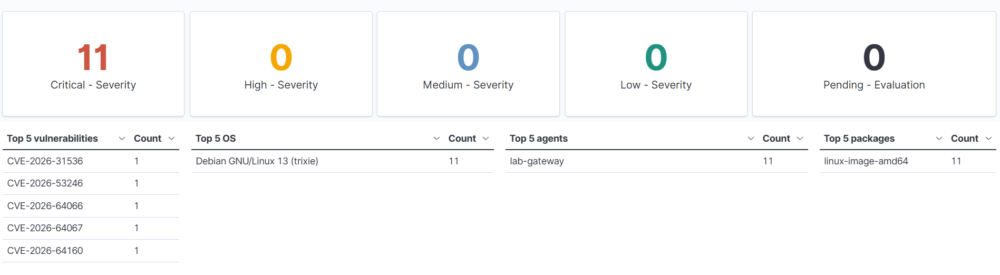
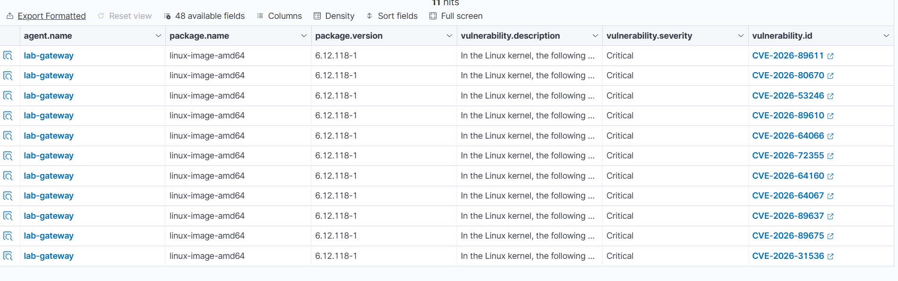
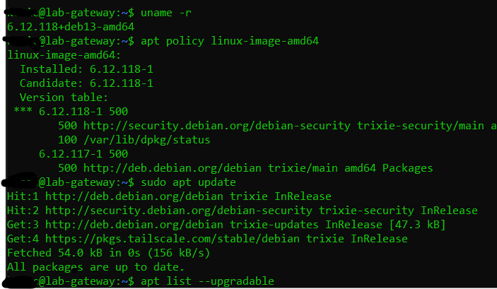

# Case Study 001 — Linux Kernel Vulnerability Assessment and Remediation

## Overview

This case study documents the identification, assessment, and remediation of 11 critical-severity Linux kernel vulnerability findings detected by Wazuh on a Debian-based security lab gateway.

The objective is to demonstrate a practical vulnerability management lifecycle, including vulnerability identification, risk assessment, patch management, operational validation, and remediation verification.

**Status:** In Progress  
**Date Initiated:** November 23, 2026  
**Classification:** Vulnerability Management / Infrastructure Security

## 1. Affected Asset

| Attribute | Details |
|---|---|
| Hostname | lab-gateway |
| Operating System | Debian GNU/Linux 13 (Trixie) |
| Asset Role | Security lab network gateway |
| Monitoring Platform | Wazuh SIEM |
| Affected Package | linux-image-amd64 |
| Detected Package Version | 6.12.118-1 |
| Reported Severity | Critical |
| Initial Vulnerability Count | 11 |

The affected endpoint provides authenticated remote access and network routing to an isolated cybersecurity testing environment.

Due to its role in network segmentation and access control, maintaining the security posture of this system is an operational priority.

## 2. Initial Detection

During routine monitoring of the Wazuh dashboard, 11 vulnerability findings were identified on the lab-gateway endpoint.

Further investigation through the Wazuh vulnerability detection inventory revealed that all 11 findings were associated with the same Linux kernel metapackage and installed package version.

### Identified Vulnerabilities

| CVE Identifier | Reported Severity | Remediation Status |
|---|---|---|
| CVE-2026-89611 | Critical | Pending validation |
| CVE-2026-80670 | Critical | Pending validation |
| CVE-2026-53246 | Critical | Pending validation |
| CVE-2026-89610 | Critical | Pending validation |
| CVE-2026-64066 | Critical | Pending validation |
| CVE-2026-72355 | Critical | Pending validation |
| CVE-2026-64160 | Critical | Pending validation |
| CVE-2026-64067 | Critical | Pending validation |
| CVE-2026-89637 | Critical | Pending validation |
| CVE-2026-89675 | Critical | Pending validation |
| CVE-2026-31536 | Critical | Pending validation |

All severity classifications and CVE identifiers were obtained from the Wazuh vulnerability inventory. Individual vulnerability applicability and fixed package versions require further validation against Debian security advisories.

### Baseline Evidence

**Figure 1 — Initial vulnerability detection summary**



**Figure 2 — Detailed vulnerability inventory showing affected package, version, severity, and CVE identifiers**



## 3. Risk Assessment

The affected system serves as a network gateway between authenticated administrative systems and an isolated cybersecurity testing environment.

Potential consequences of exploitable kernel vulnerabilities may include:

- Local privilege escalation
- Unauthorized access to system resources
- Denial of service
- Compromise of system integrity
- Disruption of gateway functionality
- Potential impact on network segmentation

These represent general kernel-related security risks rather than confirmed exploitation characteristics of every identified CVE.

### Prioritization Factors

| Factor | Assessment |
|---|---|
| Vulnerability Severity | Critical, as reported by Wazuh |
| Asset Importance | Elevated due to network gateway responsibilities |
| Network Exposure | Restricted through existing access controls |
| Evidence of Exploitation | Not established |
| Patch Availability | Under assessment |
| Remediation Priority | High |

The vulnerability findings indicate potential exposure to known software vulnerabilities. They do not independently establish evidence of exploitation or system compromise.

## 4. Remediation Strategy

Because all 11 findings were associated with the same kernel metapackage, the initial remediation strategy focuses on updating the affected package and its associated kernel dependencies.

The remediation process consists of:

1. Recording the initial vulnerability inventory.
2. Identifying installed and available kernel package versions.
3. Refreshing Debian package repository metadata.
4. Applying available operating system and security updates.
5. Rebooting the endpoint if a new kernel is installed.
6. Verifying the active kernel and installed package versions.
7. Confirming gateway functionality and Wazuh agent connectivity.
8. Reassessing the vulnerability inventory.
9. Investigating any remaining findings.

## 5. Remediation Procedure

### 5.1 Package and Kernel Assessment

Identify the installed kernel metapackage version and available upgrade candidates.

```bash
apt policy linux-image-amd64
```

Identify the currently running kernel.

```bash
uname -r
```

List installed kernel image packages.

```bash
dpkg -l 'linux-image*'
```

### 5.2 Operating System Updates

Refresh package repository metadata.

```bash
sudo apt update
```

Install available package updates.

```bash
sudo apt upgrade
```

Identify outstanding package updates.

```bash
apt list --upgradable
```

If the kernel update is held back, review package dependencies and available upgrade options before proceeding.

### 5.3 Kernel Activation

If a newer kernel is installed, perform a controlled system reboot to activate the updated kernel.

```bash
sudo reboot
```

Because the affected endpoint provides remote access to the isolated lab, the reboot will temporarily interrupt gateway availability.

### 5.4 Post-Update System Validation

Following the reboot, verify the running kernel and installed metapackage version.

```bash
uname -r
apt policy linux-image-amd64
```

Verify the Wazuh agent service.

```bash
sudo systemctl status wazuh-agent --no-pager
```

Verify authenticated overlay connectivity.

```bash
tailscale status
```


Confirm that remote access, authorized routing, and existing network segmentation controls continue to function as intended.

## 6. Post-Remediation Vulnerability Validation

Following package installation and kernel activation, Wazuh will be allowed to refresh its endpoint software inventory and reassess the affected system.

Validation criteria include:

- Wazuh agent remains connected and operational.
- Updated package versions are reflected in the endpoint inventory.
- The intended updated kernel is active.
- Previously identified CVEs are reassessed.
- Remaining vulnerabilities are investigated and documented.
- Gateway functionality and network segmentation remain operational.

Historical vulnerability alerts will be retained as evidence of the initial detection. Remediation effectiveness will be evaluated using the current vulnerability inventory rather than historical alert counts.

If findings remain after synchronization, further investigation will consider:

- Availability of Debian security patches.
- Installed and running kernel versions.
- Retained older kernel packages.
- Vulnerability intelligence accuracy.
- Debian-specific security backports.
- Inventory synchronization delays.

## 7. Remediation Results

**Status:** Pending post-remediation validation.

| Metric | Before | After |
|---|---|---|
| Kernel Metapackage | linux-image-amd64 | Pending |
| Metapackage Version | 6.12.118-1 | Pending |
| Running Kernel | Not recorded | Pending |
| Critical Vulnerability Findings | 11 | Pending |
| Vulnerabilities Remediated | 0 | Pending |
| Outstanding Vulnerabilities | 11 | Pending |
| Remediation Effectiveness | 0% | Pending |
| Wazuh Agent Connectivity | Operational | Pending |
| Gateway Functionality | Operational | Pending |

### 7.1 — Vendor Patch Availability Assessment

**Date:** November 23, 2026

Following operating system maintenance and package version validation, the installed Linux kernel was confirmed to match the latest version available through the configured Debian 13 security repositories.

Further investigation identified that CVE-2026-89611, published on September 11, 2026, remains unresolved in the currently available Debian kernel package.

| Assessment | Result |
|---|---|
| Installed Package Version | 6.12.118-1 |
| Latest Available Version | 6.12.118-1 |
| Active Kernel | 6.12.118+deb13-amd64 |
| CVE | CVE-2026-89611 |
| Vendor Patch Availability | Unavailable for installed Debian release |
| Remediation Status | Open — Awaiting Vendor Patch |
| Follow-up Action | Monitor Debian security advisories |

No unsupported kernel upgrades or vulnerability alert suppression will be implemented solely to eliminate the reported finding.

The vulnerability will remain open and subject to continued monitoring until an applicable security update becomes available. Once released, the update will be applied and remediation effectiveness will be validated through the Wazuh vulnerability inventory.

### Key Takeaway

A fully patched system is not necessarily a vulnerability-free system. Vulnerability management requires continuous monitoring, vendor advisory review, and residual risk management when security patches are not immediately available.

## 8. Lessons Learned

### Initial Observations

- Centralized vulnerability monitoring provides visibility into software-related security risks across monitored endpoints.
- Multiple vulnerability findings can originate from a single outdated software package.
- Vulnerability severity and SIEM alert severity represent different security metrics.
- Vulnerability detection alone does not establish evidence of exploitation.
- Kernel patch management requires verification of both installed packages and the actively running kernel.
- Remediation activities must account for the operational responsibilities of the affected asset.

Additional observations will be documented following remediation and validation.

## 9. Technical Skills Demonstrated

- SIEM-based vulnerability identification
- CVE tracking and vulnerability assessment
- Risk-based remediation prioritization
- Linux system administration
- Debian package management
- Linux kernel maintenance
- Security patch management
- Infrastructure security
- Operational impact assessment
- Remediation validation
- Technical reporting and documentation

## 10. Security and Scope

All assessment and remediation activities are performed within a privately owned and authorized cybersecurity lab environment.

Sensitive network addressing, credentials, authentication tokens, and other private infrastructure information are excluded from public documentation.

---

[Return to Wazuh SIEM Home Lab](../../README.md)
